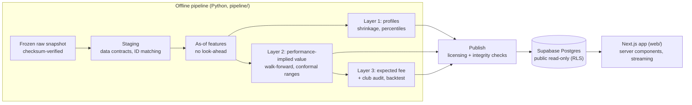

# FairValue Football

**Where does the transfer market's price disagree with the evidence, and how sure can we be?**

**Live:** https://fairvalue-football.vercel.app

FairValue compares player market values and transfer fees with what measurable performance and context usually command in the same market. Every estimate comes with an uncertainty range, labels appear only when a value falls outside that range, and the product says so when the data is too thin to judge.

> Non-commercial research and portfolio project. Data is a frozen snapshot: Transfermarkt (via the community transfermarkt-datasets project) to 6 July 2026, Understat xG to 2024/25. Raw data is never republished. See [DATA_SOURCES.md](DATA_SOURCES.md).

## What it does

| Module | Question it answers |
|---|---|
| **Player Intelligence** | How does this player's market value compare with what similar profiles carry in the same league that summer? Why? |
| **Transfer Intelligence** | Was this fee within the range comparable deals commanded at the time, or a notable premium or discount? |
| **Hidden Gems** | Which players' market values sit below the range their measurable profile usually commands, and have such flags worked historically? |
| **Club Transfer Audit** | Which clubs consistently pay more or less than expected (price efficiency, kept separate from sporting success)? |
| **Methodology** | What the models can and can't know, with live accuracy numbers and a coverage map. |

## Results (all walk-forward: each season scored by a model trained only on earlier seasons)

| Model | Scored | Typical error | Naive baseline | 80% range coverage |
|---|---:|---:|---:|---:|
| Performance-implied value, big five with xG (gradient boosting) | 10,189 player-seasons | 32.5% | 66.7% | 81.8% |
| Performance-implied value, 14 leagues, basic data (gradient boosting) | 35,362 player-seasons | 34.1% | 85.0% | 80.3% |
| Expected fee (Ridge) | 12,520 transfers | 44.4% | 50.0% (fee = market value) | 81.5% |

**Hidden Gems backtest:** players flagged as potential undervaluation gained **+7.9%** more market value than comparable peers over the next 12 months (80% CI 6.5–11.1%, n = 1,138); "strong signal" flags **+13.9%**; "market premium" players **−3.8%**. Consistent in all 10 seasons tested. Full write-ups: [model cards](reports/models/), [case studies](docs/CASE_STUDIES.md).

## How it's built



- **Pipeline** (`pipeline/`, Python): pandas, scikit-learn and SHAP; 125 tests, including leakage "future spike" tests, a walk-forward leakage canary, conformal-coverage and SHAP-additivity tests.
- **Database** (`supabase/`): 11 tables and 3 views; row-level security allows public `SELECT` only (verified by `fairvalue db-check`); a check constraint refuses any estimate stored without its range.
- **Web** (`web/`): Next.js 16 App Router, TypeScript, Tailwind v4, shadcn/ui, Recharts. All data pages are partial prerenders that stream data behind Suspense; filters live in the URL; a CI check bans verdict language such as "overpaid".

## Key decisions

The reasoning behind 17 non-obvious choices is in [docs/DECISIONS.md](docs/DECISIONS.md). Highlights:

- **No look-ahead anywhere** (D2, D4): snapshot-only fields never enter the pipeline; season stats come only from seasons that had finished before a transfer, including COVID-delayed 2019/20.
- **Drift handled explicitly** (D8, D9): the market became more unequal and leagues drifted against the big five, so predictions are re-centred each season and a point-in-time league market level is a feature.
- **Peer-relative gaps** (D11): a player is compared with same-league peers in the same summer, so league-wide market moves aren't mistaken for individual undervaluation.
- **Pre-registered model selection** (D10, D12): gradient boosting ships only if it beats Ridge by ≥ 5% without worse calibration. It did for player values and didn't for fees.

## Limitations

The valuation target is Transfermarkt's crowd opinion, including its biases. Contract length, injuries and club conventions are invisible. There are no defensive or goalkeeping metrics in free data, and ranges are wide (about ×3.6 for player values, ×9 for fees). The data is frozen: FBref lost its Opta data in January 2026, transfermarkt-datasets stopped updating in July 2026, and Understat went offline in November 2026. See the [feasibility study](reports/feasibility/FEASIBILITY_REPORT.md) and the Methodology page.

## Repository

| Path | What |
|---|---|
| `pipeline/` | Python package `fairvalue`: ingest → staging → features → models → publish |
| `web/` | Next.js application (read-only) |
| `supabase/` | SQL migrations, row-level security |
| `docs/` | [Product spec](docs/PRODUCT_SPEC.md), [decisions](docs/DECISIONS.md), [case studies](docs/CASE_STUDIES.md), [Supabase setup](docs/SUPABASE_SETUP.md), [deployment](docs/DEPLOY.md) |
| `reports/` | Feasibility study, data quality, model cards, backtest |

## Running it

```bash
# Python pipeline (needs the local raw snapshot, see DATA_SOURCES.md)
python -m venv .venv && .venv/Scripts/python -m pip install -e "pipeline[dev]"
.venv/Scripts/fairvalue stage       # verify checksums, build staging tables
.venv/Scripts/fairvalue features    # as-of features and performance profiles
.venv/Scripts/fairvalue train-piv   # performance-implied value (walk-forward) + model card
.venv/Scripts/fairvalue train-fee   # expected fee, club audit, backtest
.venv/Scripts/fairvalue check       # reconcile with published numbers
.venv/Scripts/fairvalue db-load     # publish to Supabase (needs .env)
.venv/Scripts/fairvalue db-check    # verify public read-only access

# Web app (needs web/.env.local, see docs/SUPABASE_SETUP.md)
cd web && npm install && npm run dev   # http://localhost:3000
```

Progress log: [PROGRESS.md](PROGRESS.md).
